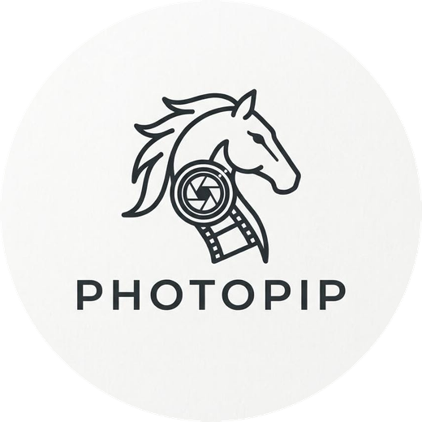

<div align="center">
  
  <h1>Photopip</h1>
  <p>Aplikasi web <em>photobooth</em> dan editor foto interaktif berbasis Next.js dan Fabric.js dengan dukungan beragam tema bingkai, stiker, font kustom, serta 7 pilihan bahasa.</p>

  <p>
    
    
    
    
    
  </p>
</div>

---

## ✨ Fitur Utama

| Fitur | Deskripsi |
| :--- | :--- |
| 📸 **Studio Photobooth Interaktif** | Pengambilan foto langsung via kamera perangkat (`use-camera`, `booth-stage`) menggunakan Web API kamera browser lengkap dengan hitung mundur, *film strip* pratinjau, serta opsi unggah foto dari galeri. |
| 🖼️ **Layout & Frame Pack Tematik** | Mendukung format `single`, `2x2`, `2x3`, `3x1`, dan `4x1` dengan pack bawaan seperti `default`, `cyber-glow`, `gta-6`, `matcha-latte`, `minecraft`, `monochrome-noir`, `pastel-party`, `retro-night`, dan `sunset-vibes`. |
| 🎨 **Editor Foto & Manajemen Layer** | Kanvas interaktif berbasis **Fabric.js** dengan riwayat *Undo/Redo*, pengaturan urutan *layer* (`layer-list`), filter foto (`photo-filters`), stiker (`cute`, `emoji`, `food`, `nature`, `y2k`), dan kustomisasi teks/font. |
| ⚡ **Auto-Discovery Asset API** | Endpoint `/api/frames`, `/api/stickers`, dan `/api/fonts` memindai aset di folder `public/assets/` secara otomatis. |
| 🌐 **Dukungan Multi-Bahasa (7 Bahasa)** | Antarmuka tersedia dalam bahasa **Indonesia (`id`)**, **Inggris (`en`)**, **Jerman (`de`)**, **Spanyol (`es`)**, **Prancis (`fr`)**, **Jepang (`ja`)**, dan **Mandarin (`zh`)**. |
| 📱 **PWA Ready & Ekspor Instan** | Dilengkapi `manifest.json` dan ikon aplikasi agar dapat dipasang sebagai aplikasi web, serta ekspor hasil komposisi foto ke perangkat. |

---

## 🛠️ Teknologi yang Digunakan

* **Next.js (`^16.4.5`) & React (`^19.3.0`):** Kerangka web utama untuk struktur halaman (`src/app/`), antarmuka pengguna, serta *API routes* (`/api/frames`, `/api/stickers`, `/api/fonts`).
* **Fabric.js (`7.4.0`):** *Library* kanvas interaktif terpisah di atas Next.js yang digunakan di editor foto untuk mengatur posisi, skala, rotasi, *layer* stiker/teks, dan komposisi visual.
* **Sharp (`0.35.5`):** *Library* pemrosesan gambar yang terdaftar pada proyek untuk kebutuhan manipulasi dan optimasi gambar.
* **TypeScript (`5.9.3`) & CSS (`src/app/globals.css` + `next-themes`):** Pengetikan tipe statis, *styling* global, dan pengelolaan tema.
* **Vitest (`4.1.11`), React Testing Library (`16.3.0`), ESLint, Prettier & Knip:** Pengujian unit/komponen, pengecekan *lint/formatting*, dan audit kode.

---

## 📋 Prasyarat Instalasi

Sebelum menjalankan proyek secara lokal, siapkan kebutuhan berikut:

* **Node.js versi `>= 22.0.0`:** Saat kamu menginstal Node.js, **npm** (paket manajer untuk menjalankan perintah seperti `npm install` dan `npm run dev`) sudah otomatis ikut terpasang di dalamnya.
* **Browser modern:** Mendukung akses kamera (`MediaDevices.getUserMedia`) jika ingin memotret langsung dari webcam atau kamera perangkat.

---

## 🚀 Instalasi & Menjalankan Proyek

1. **Clone repositori ini:**
   ```bash
   git clone https://github.com/rafifnurfariz/Photopip.git
   cd Photopip
   ```

2. **Instal seluruh dependensi:**
   ```bash
   npm install
   ```

3. **Jalankan server pengembangan (*development*):**
   ```bash
   npm run dev
   ```

4. **Buka di browser:**
   Akses **`http://localhost:3000`** untuk mulai menggunakan Photopip.

5. **Menjalankan pengujian & build produksi:**
   ```bash
   # Menjalankan unit & component test dengan Vitest
   npm test

   # Membuat build produksi
   npm run build
   npm start
   ```

---

## 📂 Susunan Project

```text
Photopip/
├── public/
│   ├── assets/
│   │   ├── app-icons/       # Favicon & ikon PWA (16x16 hingga 512x512)
│   │   ├── brand/           # Logo resmi aplikasi (logo.png)
│   │   ├── fonts/           # File font publik untuk editor/kanvas
│   │   ├── frame-packs/     # Koleksi bingkai (2x2, 2x3, 3x1, 4x1, single)
│   │   └── stickers/        # Koleksi stiker per kategori (cute, emoji, food, nature, y2k)
│   └── manifest.json        # Konfigurasi Web App Manifest
├── scripts/                 # Skrip audit produksi, packaging, & sinkronisasi frame
├── src/
│   ├── app/
│   │   ├── api/             # API routes pemindai aset (fonts, frames, stickers)
│   │   ├── globals.css      # Styling global
│   │   ├── layout.tsx       # Root layout aplikasi
│   │   └── page.tsx         # Halaman utama
│   ├── assets/              # Aset internal (misal font tambahan)
│   ├── components/          # Komponen UI umum (header, icons, theme-provider)
│   ├── features/
│   │   ├── editor/          # Kanvas editor (Fabric.js), panel properti, layer, stiker, teks
│   │   └── studio/          # Kamera, sesi capture, film strip, & kontrol ekspor
│   ├── shared-tools/
│   │   ├── catalog/         # Definisi template, filter foto, & parser frame pack
│   │   └── composition/     # Mesin render komposisi, geometri, & ekspor gambar
│   └── translations/        # File lokalisasi 7 bahasa & hook use-language
├── tests/                   # Suite pengujian otomatis berbasis Vitest
├── TUTORIAL.md              # Panduan penggunaan & kustomisasi lanjutan
├── next.config.mjs          # Konfigurasi Next.js
├── package.json             # Daftar dependensi & skrip npm
└── tsconfig.json            # Konfigurasi TypeScript
```

---

## 💡 Contoh Penggunaan

### 1. Sesi Photobooth & Editing Dasar

1. Buka `http://localhost:3000` dan izinkan akses kamera pada browser (atau unggah foto dari perangkat).
2. Pilih **Layout Template** (misalnya `4x1` atau `2x2`) dan **Frame Pack** pilihanmu (contoh: `cyber-glow` atau `matcha-latte`).
3. Tekan tombol **Capture** untuk mengambil foto sesuai slot template.
4. Masuk ke mode **Editor** untuk menerapkan filter foto, menambahkan stiker atau teks, dan mengatur urutan *layer*.
5. Klik tombol **Export** untuk mengunduh hasil akhir ke perangkat.

### 2. Cara Menambah Frame Pack Baru

1. Buat folder baru di dalam `public/assets/frame-packs/`, misalnya:
   ```text
   public/assets/frame-packs/vintage-film/
   ```
2. Letakkan file gambar bingkai (`.png`) sesuai format layout yang ingin didukung di dalam folder tersebut:
   * `single.png`
   * `2x2.png`
   * `2x3.png`
   * `3x1.png`
   * `4x1.png`
3. Muat ulang halaman aplikasi, maka endpoint `/api/frames` akan otomatis membaca folder *frame pack* baru di `public/assets/frame-packs/`.

### 3. Cara Menambah Stiker Baru

1. Pilih folder kategori stiker yang sudah ada di `public/assets/stickers/` (seperti `cute/`, `emoji/`, `food/`, `nature/`, atau `y2k/`), atau buat folder kategori baru di dalamnya:
   ```text
   public/assets/stickers/cute/
   ```
2. Masukkan file gambar stiker (disarankan PNG berlatar transparan), misalnya `star_sparkle.png`.
3. Muat ulang halaman aplikasi, maka endpoint `/api/stickers` akan otomatis memindai file stiker dari folder tersebut agar muncul di panel stiker editor.

### 4. Cara Menambah Font Baru

1. Masukkan file font (seperti `.ttf` atau format font yang didukung) ke folder:
   ```text
   public/assets/fonts/
   ```
   *(Contoh: `public/assets/fonts/Poppins-Bold.ttf`)*
2. Muat ulang halaman aplikasi, maka endpoint `/api/fonts` akan otomatis mendeteksi font di `public/assets/fonts/` sehingga bisa langsung dipilih pada panel teks di editor.